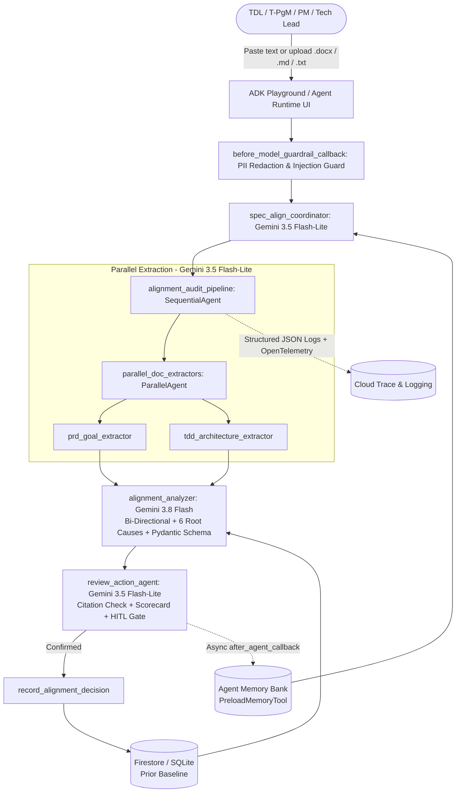

# SpecAlign — Multi-Agent PRD-to-TDD Alignment Auditor

SpecAlign is an enterprise multi-agent solution built with the Google Agent Development Kit (**ADK-Python 2.x**) and deployed to **Google Cloud Agent Runtime**. It compares Product Requirements Documents (PRDs), optional Business Goals/OKR Charters, and Technical Design Documents (TDDs) before sprint kickoff to surface missing coverage, contradictions, scope creep, vague PRD specs, and stale PRDs built from verbal conversations—with verbatim section citations, human-in-the-loop sign-off, and cross-session revision tracking.

---

## Architecture



### Six Drift Root-Cause Categories

| Category | Meaning | Action Owner |
| :--- | :--- | :--- |
| `INTENTIONAL_TRADEOFF` | TDD explicitly justifies deviating due to cost, quota, or platform constraint | `PM` (ratify & update PRD) |
| `ACCIDENTAL_OMISSION` | Stated PRD/OKR requirement has zero TDD coverage | `Engineering` |
| `UNDOCUMENTED_CONTRADICTION` | TDD directly violates a PRD/Charter constraint (region, SLA, security) | `Engineering` (**Blocker**) |
| `UNJUSTIFIED_SCOPE_CREEP` | TDD adds major infrastructure/features with zero backing business goal | `Engineering` |
| `AMBIGUOUS_PRD_SPEC` | PRD uses vague wording (e.g. "fast") forcing TDD assumptions | `PM` |
| `STALE_OR_MISSING_PRD_SPEC` | PRD omitted rules completely; TDD built them from verbal syncs/meetings | `PM / T/PgM` (PRD Backfill) |

---

## Repository Structure

```text
specalign-agent/
├── .github/workflows/ci.yml       # GitHub Actions CI (ruff, pytest, agents-cli lint)
├── agents-cli-manifest.yaml       # Agent Runtime deployment manifest (us-central1)
├── Dockerfile                     # Container image definition for Agent Runtime
├── LICENSE                        # Apache 2.0 open-source license
├── pyproject.toml                 # PEP 621 dependencies & hatchling build config
├── scripts/
│   └── deploy.sh                  # Programmatic IaC script (APIs, IAM SA, Firestore, deploy)
├── app/
│   ├── .env.example               # Environment template (copy to app/.env, gitignored)
│   ├── agent.py                   # 4-agent topology, Flash/Pro routing, HITL, Memory Bank, ContextFilterPlugin
│   ├── callbacks.py               # PII redaction (email/SSN/credit card/phone/secret), injection guard & async Memory callback
│   ├── schemas.py                 # Pydantic v2 models, citation verifier & Executive Scorecard renderer
│   ├── storage.py                 # Cloud Firestore Native (project=) & local SQLite audit stores
│   ├── telemetry.py               # Structured JSON intent-vs-outcome logging & OpenTelemetry spans
│   └── tools/
│       ├── doc_tools.py           # Option A ingestion (paste/.docx/.md/.txt) & bounded section readers
│       └── audit_tools.py         # Baseline lookup, citation check, v1->v2 diff & HITL decision tool
├── docs/
│   ├── PRD.md                     # Product Requirements Document
│   ├── TDD.md                     # Technical Design Document (BUILD/SCALE/GOVERN/OPTIMIZE)
│   └── stories/                   # Sharded sprint story packets (S1-01..S1-06, S2-01..S2-02)
├── evals/
│   ├── eval_config.json           # ADK eval thresholds
│   ├── specalign_golden.test.json # 7-case planted-defect ADK EvalSet
│   └── fixtures/                  # TC-01..TC-07 clean-room synthetic PRD/TDD pairs
└── tests/                         # Automated unit & contract test suite (unittest / pytest)
```

---

## Quick Start (Google Cloud Shell or Linux)

### 1. Install `uv`, `google-agents-cli`, and Project Dependencies

```bash
curl -LsSf https://astral.sh/uv/install.sh | sh
export PATH="$HOME/.local/bin:$PATH"
uv tool install google-agents-cli

cd specalign-agent
uv sync
cp app/.env.example app/.env
# Edit app/.env with your target GOOGLE_CLOUD_PROJECT
```

### 2. Run Unit Tests, Lint, and Golden Evaluation Suite

```bash
# Unit & contract tests (works offline with stdlib unittest or uv pytest)
uv run pytest -q
# Or without uv:
python3 -m unittest discover -s tests -v

# ADK static lint check
agents-cli lint

# 7-case planted-defect golden evaluation suite
uv run adk eval app evals/specalign_golden.test.json --config_file_path evals/eval_config.json
```

### 3. Test Locally in the Playground

```bash
agents-cli playground
```

Open `http://127.0.0.1:8080` (or **Web Preview → Port 8080** in Cloud Shell) and either paste PRD/TDD text directly from Google Docs (*Edit → Copy as Markdown*) or point to any fixture under `evals/fixtures/`.

### 4. Deploy to Google Cloud Agent Runtime (Programmatic IaC & Least-Privilege IAM)

Run the included end-to-end IaC deployment script (enables required GCP APIs, creates `specalign-agent-sa`, binds the 4 least-privilege IAM roles, ensures Firestore Native `(default)` exists, runs `pytest` + `agents-cli lint`, and deploys to Agent Runtime):

```bash
export PROJECT_ID=$(gcloud config get-value project)
chmod +x scripts/deploy.sh
./scripts/deploy.sh
```

Or deploy manually step by step:

```bash
export PROJECT_ID=$(gcloud config get-value project)

# Provision dedicated least-privilege service account
gcloud iam service-accounts create specalign-agent-sa \
  --display-name="SpecAlign Agent SA"

for ROLE in roles/aiplatform.user roles/datastore.user roles/logging.logWriter roles/cloudtrace.agent; do
  gcloud projects add-iam-policy-binding "${PROJECT_ID}" \
    --member="serviceAccount:specalign-agent-sa@${PROJECT_ID}.iam.gserviceaccount.com" \
    --role="${ROLE}"
done

# Ensure Native Firestore (default) database exists
gcloud firestore databases create --database="(default)" --location=us-central1 --type=firestore-native --project="${PROJECT_ID}"

# Deploy to Agent Runtime (auto-wires Sessions, Memory Bank & OpenTelemetry Cloud Trace)
agents-cli deploy \
  --service-account "specalign-agent-sa@${PROJECT_ID}.iam.gserviceaccount.com" \
  --region us-central1 \
  --project "${PROJECT_ID}"
```

### 5. Clean Up Cloud Resources (`?force=true` Required for Child Sessions/Memories)

```bash
RUNTIME_ID=$(jq -r .remote_agent_runtime_id deployment_metadata.json)
curl -X DELETE \
  -H "Authorization: Bearer $(gcloud auth print-access-token)" \
  "https://us-central1-aiplatform.googleapis.com/v1/${RUNTIME_ID}?force=true"
rm -f deployment_metadata.json
```

---

## L200 AgentOps Rubric Mapping (95 Points)

| Rubric Pillar | Implementation in SpecAlign |
| :--- | :--- |
| **1. Tool & Interface Design** | Action-oriented tools (`ingest_document`, `list_doc_sections`, `read_doc_section`, `get_previous_audit`, `verify_alignment_citations`, `record_alignment_decision`) with full docstrings, Pydantic v2 schemas, and structured `recovery_guidance` error envelopes. |
| **2. Context & Memory** | Constitution system instructions, bounded section-chunked reading (`MAX_SECTION_READS=15`) + `ContextFilterPlugin` history compaction, Firestore/SQLite revision baselines, and async `after_agent_callback` + `PreloadMemoryTool()` Memory Bank wiring. |
| **3. Orchestration & Logic** | Coordinator → `SequentialAgent` → `ParallelAgent` 4-agent topology, strategic Flash/Pro model routing, `before_model_guardrail_callback` PII & prompt-injection defense, and dual-layer HITL confirmation (`FunctionTool(..., require_confirmation=True)` + `human_confirmed` + Blocker risk-waiver check). |
| **4. Observability & Tracing** | Zero bare `print()` statements, `JsonLogFormatter` emitting correlated pre-tool `tool_intent` and post-tool `tool_outcome` (including exception) JSON logs, OpenTelemetry Cloud Trace spans, and deterministic PII redaction across emails, SSNs, credit cards, phone numbers, and secrets (`0%` leak rate). |
| **5. Infrastructure & CI/CD** | 7-case planted-defect `adk eval` suite (`TC-01`–`TC-07`), automated unit tests, `.github/workflows/ci.yml` CI pipeline, programmatic `scripts/deploy.sh` + `agents-cli-manifest.yaml` + `Dockerfile` IaC workflow, and zero hardcoded secrets (ADC / gitignored `app/.env`). |
